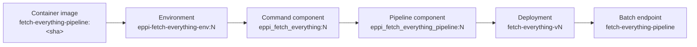

# Releasing a new version

The pipeline runs in Azure ML behind the `fetch-everything-pipeline` batch endpoint. A release builds a new container image and registers new versions of each layer on top of it. Then it adds a new deployment to the endpoint and makes that deployment the default.



The endpoint URL stays consistent and defaults to the latest deployment. Callers, including ADF, call `https://fetch-everything-pipeline.<region>.inference.ml.azure.com/jobs` without naming a deployment, so each call goes to the endpoint's current default deployment. Don't pin a deployment in callers with the `azureml-model-deployment` header: they would then stop following releases.

## Versions can't be changed once registered

Environment and component versions are immutable. Once a version is registered, it can't be overwritten or reused, even if it was registered by mistake. To fix a registered version, register the next one.

Each layer has its own version number, so the numbers don't have to match. If only the pipeline component's defaults change, for example, register a new pipeline component version and leave the environment and command component alone. Name each deployment after the pipeline component version it runs (`fetch-everything-vN` runs `eppi_fetch_everything_pipeline:N`).

Deployments can be changed, but in this repo follow the pattern of creating a new one for each release to enable rollbacks.

## Steps

Placeholders: `<acr>` is the workspace's container registry, `<sha>` is the commit being released, and `N` is the next version of each layer.

### 1. Commit the change

`az acr build` uploads the contents of the current directory filtered by `.dockerignore`. Make sure you don't commit any untracked or modified files and that the working tree is clean so the image matches the SHA it's tagged with.

```bash
git status   # <- should show no changes
```

### 2. Build and push the image

Requires Azure CLI with the `ml` extension installed, and authentication against the Azure subscription containing the container registry with `az login`.

```bash
az acr build -r <acr> -t fetch-everything-pipeline:<sha> --platform linux/amd64 .
```

### 3. Register the environment

The environment runs the image as it is. If you try and create this via the UI, a conda file is mentioned. That's omitted entirely here.

```bash
az ml environment create --name eppi-fetch-everything-env --version N \
  --image <acr>.azurecr.io/fetch-everything-pipeline:<sha>
```

### 4. Register the command component

Bump `version` in `azureml/component.yml`, then:

```bash
az ml component create -f azureml/component.yml
```

The component uses `eppi-fetch-everything-env@latest` (the latest commit, or version of the deployed image), so register the environment (step 3) first.

### 5. Register the pipeline component

Bump `version` in `azureml/pipeline-component.yml`. Before registering, check that the `key_vault_url` and `mailto` defaults are the real values, not placeholders. Callers rely on these defaults. With a placeholder vault URL, every call exits with code 1, and fixing it takes a new version.

```bash
az ml component create -f azureml/pipeline-component.yml
```

The pipeline component uses `eppi_fetch_everything@latest`, so register the command component (step 4) first.

### 6. Create the deployment

In `azureml/deployment.yml`, set `name` to `fetch-everything-vN` and `component` to `azureml:eppi_fetch_everything_pipeline:N`, then:

```bash
az ml batch-deployment create -f azureml/deployment.yml --set-default -g <resource-group> -w <azure-ml-workspace>
```

Note that passing `--set-default` makes this deployment the default immediately.

Then check which deployment is the default:

Test it straight away (step 7) and switch the default back (see [Rolling back](#rolling-back)) if this fails.

### 7. Test the deployment by name

Point the `results` output path in `azureml/invoke-test.yml` at a folder that doesn't exist yet, for example `runs/endpoint-test-vN-1/`. Output folders must be new for every call. Then:

```bash
az ml batch-endpoint invoke -n fetch-everything-pipeline \
  --deployment-name fetch-everything-vN -f azureml/invoke-test.yml
```

The test passes when:

- the job completes and `results.csv` is in the output folder;
- `std_log.txt` lists the providers you expect (`Enabled providers: ...`).

## Rolling back

Make the previous deployment the default again:

```bash
az ml batch-endpoint update -n fetch-everything-pipeline --set defaults.deployment_name=fetch-everything-v<N-1> -g <resource-group> -w <azure-ml-workspace>
```
