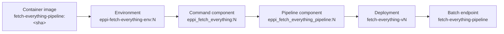

# Releasing a new version

The pipeline runs in Azure ML behind the `fetch-everything-pipeline` batch endpoint. A release builds a new container image and registers new versions of each layer on top of it. Then it adds a new deployment to the endpoint, tests it, and makes it the default.



The endpoint URL stays consistent and defaults to the latest deployment. Callers, including ADF, call `https://fetch-everything-pipeline.<region>.inference.ml.azure.com/jobs` without naming a deployment, so each call goes to the endpoint's current default deployment. Don't pin a deployment in callers with the `azureml-model-deployment` header: they would then stop following releases.

## Versions can't be changed once registered

Environment and component versions are immutable. Once a version is registered, it can't be overwritten or reused, even if it was registered by mistake. To fix a registered version, register the next one.

Each layer has its own version number, so the numbers don't have to match, and skipping a number is fine. Using the same `N` for every layer in a release makes it easy to see which versions belong together. Name each deployment after the pipeline component version it runs (`fetch-everything-vN` runs `eppi_fetch_everything_pipeline:N`).

Deployments can be changed, but in this repo follow the pattern of creating a new one for each release to enable rollbacks.

## Steps

Placeholders: `<acr>` is the workspace's container registry, `<sha>` is the commit being released, `N` is the next version of each layer, and `<rg>` and `<ws>` are the resource group and Azure ML workspace. Instead of passing `-g <rg> -w <ws>` each time, you can set them once with `az configure --defaults group=<rg> workspace=<ws>`.

All steps need the Azure CLI with the `ml` extension installed, signed in with `az login` to the subscription that holds the workspace and container registry.

### 1. Commit the change

`az acr build` uploads the contents of the current directory, filtered by `.dockerignore`. Commit everything and make sure the working tree is clean, so the image matches the SHA it's tagged with.

```bash
git status   # <- should show no changes
```

### 2. Build and push the image

```bash
az acr build -r <acr> -t fetch-everything-pipeline:<sha> --platform linux/amd64 .
```

### 3. Register the environment

The environment runs the image as it is. If you create it in the UI instead, a conda file is mentioned, but it's omitted entirely here as the image already contains all dependencies.

```bash
az ml environment create --name eppi-fetch-everything-env --version N \
  --image <acr>.azurecr.io/fetch-everything-pipeline:<sha> -g <rg> -w <ws>
```

### 4. Register the components

Bump `version` in `azureml/component.yml` and `azureml/pipeline-component.yml`.

Then register both components with `azureml/register.sh`:

```bash
KEY_VAULT_URL=https://<vault>.vault.azure.net/ MAILTO=<contact email> \
  azureml/register.sh -g <rg> -w <ws>
```

The script:

- stops if `KEY_VAULT_URL` or `MAILTO` is unset or empty, and at the first command that fails.
- registers the command component first, then the pipeline component. Each refers to the layer below with `@latest`, which is resolved to the most recently registered version when the component is registered. So the environment (step 3) must be registered before the command component, and the command component before the pipeline component.
- sets `KEY_VAULT_URL` and `MAILTO` as the registered pipeline component's `key_vault_url` and `mailto` defaults with `--set`. These are specific to each deployment and kept out of the repo, so `pipeline-component.yml` has no defaults for them. Callers that omit these inputs (ADF, `invoke-test.yml`) rely on the registered defaults.
- passes any extra arguments, such as `-g` and `-w`, to both `az ml component create` calls.

### 5. Check what was registered

```bash
az ml component show --name eppi_fetch_everything_pipeline --version N -g <rg> -w <ws> --query inputs
az ml component show --name eppi_fetch_everything --version N -g <rg> -w <ws> --query environment
```

`key_vault_url` and `mailto` should have the real vault URL and contact email as their defaults, and the command component's environment should end in `/versions/N` (the environment from step 3). If any of these are wrong, stop here and register the next version before deployment proceeds.

### 6. Create the deployment

In `azureml/deployment.yml`, set `name` to `fetch-everything-vN`, `component` to `azureml:eppi_fetch_everything_pipeline:N`, and update the description. Then create the deployment without making it the default:

```bash
az ml batch-deployment create -f azureml/deployment.yml -g <rg> -w <ws>
```

Check that the endpoint's default is still the previous deployment, so callers aren't affected yet:

```bash
az ml batch-endpoint show -n fetch-everything-pipeline -g <rg> -w <ws> --query defaults
```

### 7. Test the deployment by name

Point the `results` output path in `azureml/invoke-test.yml` at a folder that doesn't exist yet, for example `runs/endpoint-test-vN-1/`. Output folders must be new for every call. `invoke-test.yml` leaves out `key_vault_url`, as ADF does, so this also checks the registered default. Then:

```bash
az ml batch-endpoint invoke -n fetch-everything-pipeline \
  --deployment-name fetch-everything-vN -f azureml/invoke-test.yml -g <rg> -w <ws>
```

A job that completes isn't enough on its own. Per-DOI failures are recorded in `results.csv` and the job still succeeds, so a deployment that fetches nothing would also complete. The test DOI file should include DOIs known to be retrievable, taken from `fetched` rows in a previous run's `results.csv`, with at least one from each provider you expect to use (including OpenAlex).

Download the output folder to check it, for example with `az ml job download`.

The test passes when:

- the job completes, and `results.csv` has one row per input line;
- the known-retrievable DOIs have `status` `fetched`, from the providers you expect (`source`);
- each `fetched` row's `path` exists under `pdfs/` and is a PDF: `head -c 5 <file>` prints `%PDF-`.

If the known-retrievable DOIs aren't fetched, check the `error` column in `results.csv` and `std_log.txt` (including any "fulltext providers failed" warnings) before deciding

- a transient failure at a provider: invoke again with a new output folder
- a failure that repeats, or one in this code: don't make the deployment the default

Until step 8, the previous deployment is still the default, so callers are unaffected. Fix the problem and release the next version.

### 8. Make it the default

```bash
az ml batch-endpoint update -n fetch-everything-pipeline \
  --set defaults.deployment_name=fetch-everything-vN -g <rg> -w <ws>
```

Then tag the released commit, for example `git tag vN-deployment <sha>`, so you can find what each deployment runs.

## Rolling back

Make the previous deployment the default again:

```bash
az ml batch-endpoint update -n fetch-everything-pipeline \
  --set defaults.deployment_name=fetch-everything-v<previous-version-number> -g <rg> -w <ws>
```
